# 문규성 포트폴리오


Unity와 C#으로 게임 클라이언트를 개발하는 문규성입니다. 

방치형 RPG ‘왕국군 키우기’에서는 현재 기획자와 2인 팀으로 Unity 클라이언트의 신규 기능 구현부터 서버 API 연동과 배포까지 개발을 전담하고 있으며 스토브에 출시한 ‘Demon N Defense’에서는 웨이브 진행과 이어하기를 설계해 팀원들이 구현한 기능을 연결했습니다.
<br clear="left"/>

## 기술스택

| 구분 | 기술 |
| --- | --- |
| Language |  |
| Engine |  |
| Library / SDK |   |
| Data |   |
| Collaboration |    |

## 핵심기술

- [스테이지 정의·런타임 상태·클리어 규칙 분리](#project-k-stage): 던전 추가와 메인 스테이지 복귀를 고려한 구조 설계
- [씬 전환·게임 시작 파이프라인 재구성](#project-k-loading): 리소스 준비, 씬 활성화, 런타임 초기화 순서 보장
- [데이터 로딩·매니저 초기화 순서 보장](#idle-hero-bootstrap): Addressables 로딩 완료 후 시스템 초기화
- [입력 주체와 공통 전투 실행 계층 분리](#personal-combat): 플레이어와 AI의 전투 로직 재사용
- [조합형 상호작용과 이벤트 기반 UI 분리](#kamikakushi-interaction): 탐지·실행·화면 갱신의 결합도 완화

## 프로젝트 목차

| 구분 | 프로젝트 | 장르 | 기간 | 역할 | 연결 링크 |
| --- | --- | --- | --- | --- | --- |
| 팀 프로젝트 | [왕국군 키우기](#project-k) | 방치형 RPG | 2026. 05 – 진행 중 | 클라이언트 개발 | [YouTube](https://www.youtube.com/watch?v=PBKFwkjvW5U) |
| 팀 프로젝트 | [Demon N Defense](#demon-n-defense) | 2D 오토배틀 디펜스 | 2026. 09. 02 - 2026.11.09 | 코어 · 웨이브 · UI 개발 | [STOVE](https://store.onstove.com/ko/games/106168) |
| 팀 프로젝트 | [귀차니즘 용사](#team-project-2) | 방치형 RPG | 2026. 03. 03 - 2026. 04. 15 | 클라이언트 리드 | [GitHub](https://github.com/ks0521/TeamProject)<br>[YouTube](https://youtu.be/7LdXl2Ow0QU) |
| 개인 프로젝트| [그때 갑자기 건담이 나타났다](#personal-project) | TPS 로그라이크 | 2026. 01. 29 - 2026. 02. 27 | 1인 개발 | [GitHub](https://github.com/ks0521/SingleProject)|
| 팀 프로젝트 | [카미카쿠시](#team-project-1) | 공포 | 2025. 12. 10 - 2025. 12. 26 | 클라이언트 리드 | [GitHub](https://github.com/ks0521/First-Game-Project)<br>[YouTube](https://www.youtube.com/watch?v=v1zOEZXVuqY) |

---
<div style="page-break-before: always;"></div>

<a id="project-k"></a>
# 왕국군 키우기

<p align="center">
  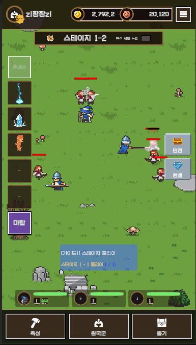
  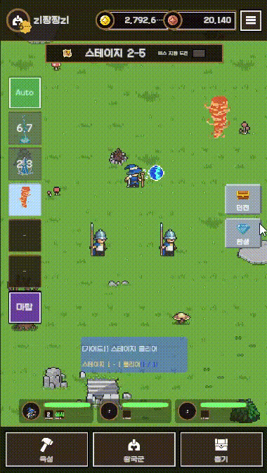
</p>

실제 출시를 목표로 제작 중인 방치형 RPG입니다. 기존 프로토타입의 기능을 유지하면서 콘텐츠 추가와 운영에 대응할 수 있도록 스테이지, 장비, 성장 구조를 재정리하고 있습니다.

- **프로젝트 기간** : 2026.02 – 진행 중
- **본인 참여 기간** : 2026.05 – 진행 중
- **팀 구성** : 초기 3인 → 2인 개발(~2026.10)
- **본인 역할** : 클라이언트 개발
- **개발 환경** : Unity 6, C#, UniTask, Addressables

<a id="project-k-stage"></a>
## 🧩 핵심 구현 1. 육성 요청 배칭과 낙관적 UI 업데이트

> **문제**
> 
> 플레이 중 골드 육성 버튼을 누를 때마다 서버 응답이 올 때까지 다음 강화를 누를 수 없었고 이로인해 계속해서 강화를 시도할 수 있는 방치형 RPG 게임의 플레이 흐름을 지속적으로 끊었습니다
> <br>처음에는 서버 응답 시간을 줄이는 방법을 살폈지만 기존 버전으로 강화를 반복한 테스트에서 연속적인 육성시도마다 PlayFab의 플레이어별 저장 호출 제한(HTTP 429)이 발생했습니다

>여러 입력을 묶어 보내더라도 화면이 서버 응답 시점에만 바뀌면 조작 지연은 그대로 남았습니다. 특히 사냥으로 강화 비용을 막 채웠을 때 화면에 보이는 골드와 강화 버튼이 판단하는 잔액이 일치해야 플레이어가 자연스럽게 다음 육성을 시도할 수 있었습니다

### 해결

사냥 보상과 육성 입력은 발생 순서대로 모아 서버에 보내고 화면에는 입력 결과를 먼저 보여주는 낙관적 UI 업데이트 방식을 적용했습니다
 - 사냥 골드 표시와 강화 가능 여부에 같은 예상 잔액을 사용했습니다. 마지막으로 서버가 확정한 잔액에 아직 정산되지 않은 사냥 골드를 더하고, 이미 누른 강화 비용을 차감했습니다. 덕분에 몬스터를 잡아 강화 비용을 채우면 정산 응답 전에도 버튼이 활성화되고, 강화를 누르는 즉시 예상 레벨과 남은 골드가 표시됩니다.
 - 서버는 사냥과 강화를 발생 순서대로 검증했습니다. 먼저 발생한 처치 보상을 정산한 뒤 강화 비용을 확인합니다. 클라이언트는 응답이 오면 확정값을 기준으로 화면을 보정하고, 실제 전투 능력치와 루비 보상 배율은 서버가 확정한 단계부터 적용했습니다.
 - 골드·루비 육성과 마탑 일반 강화를 같은 배치에 통합했습니다. 한 강화가 거절되면 해당 입력과 그 성공을 전제로 한 같은 대상의 후속 입력만 취소합니다. 이미 성공한 강화는 유지하고, 다른 대상의 강화는 각각의 조건에 따라 계속 처리합니다.

### 결과

- 실제 서버에 연결한 유니티 에디터에서 공격력 강화 입력 6건 모두 다음 프레임에 강화입력이 적용되었습니다. 사냥으로 획득한 골드 14건도 모두 같은 프레임에 HUD에 반영됐습니다
- 별도의 강화 실험에서는 10회의 강화시도가 2건의 배치로 서버에서 처리되었습니다.
- 골드와 루비, 마탑 강화 입력 10개를 한 배치에 담아 일부가 거절되는 상황도 검증했습니다. 4개는 정상 확정됐고, 거절된 3개와 후속 입력 3개만 취소됐습니다. 재접속 후에도 화면의 강화 단계와 잔액이 서버 기록과 일치했습니다.

### 개선사항

- 장비 강화는 현재 개별 요청으로 처리되어 있어 배치구조에 추가 할 예정입니다. 또한 자동 사냥 중 여러 육성을 번갈아 사용하는 조건에서 클라이언트의 배치 요청 수, 서버 내부의 PlayFab 저장 호출 수, 429 발생률을 함께 측정해 배칭이 실제 저장 호출 제한을 얼마나 줄이는지 확인하려고 합니다

## 🧩 핵심 구현 2. 스테이지 정의·런타임 상태·클리어 규칙 분리

> **문제**  
> 기존 흐름에서는 메인 스테이지 진행, 몬스터 생명주기, 클리어 판정, 던전 진입·복귀가 여러 매니저에 걸쳐 있었습니다. 진행 방식이 다른 콘텐츠가 늘어날수록 기존 코드를 함께 수정해야 했습니다.

### 해결

정적 콘텐츠 정의는 `StageDefinition`, 현재 실행 중인 몬스터와 처치 상태는 `StageSession`, 성공·실패 판정은 `IStageRule`로 분리했습니다. `StageManager`는 이들을 조합해 메인 진행, 보스 도전, 처치 수 조건, 던전 진입과 복귀를 조정합니다.

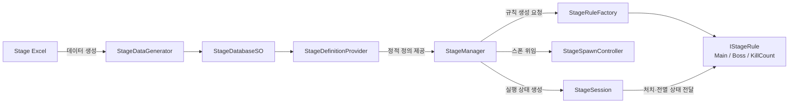

실제 규칙 선택은 데이터에 기록된 `FlowType`을 기준으로 팩토리가 담당합니다.

```csharp
public static IStageRule Create(StageDefinition definition)
{
    return definition.FlowType switch
    {
        eStageFlowType.MainProgression   => new MainStageRule(),
        eStageFlowType.BossChallenge    => new BossStageRule(),
        eStageFlowType.KillCountChallenge => new KillCountRule(),
        _ => throw new ArgumentOutOfRangeException(nameof(definition.FlowType))
    };
}
```

### 결과

- 스테이지 데이터, 실행 중 상태, 판정 규칙의 변경 이유를 분리했습니다.
- 메인 진행 상태를 보존한 뒤 던전에서 복귀 시 기존 진행 상태를 유지하는 흐름을 추가했습니다.
- 스테이지 클리어 이벤트를 퀘스트 등 다른 콘텐츠가 구독할 수 있는 기준점으로 만들었습니다.
- 새 진행 규칙을 추가할 때 기존 스폰·세션 코드를 직접 수정하는 범위를 줄였습니다.

### 개선사항

`StageManager`가 아직 진입·복귀·팝업 이벤트까지 조정하는 큰 클래스여서 콘텐츠 종류가 더 늘어나면 화면 전환과 사용자 피드백을 별도로 분리할 필요가 있습니다.<br/>
데이터 생성과 리소스 로딩 실패 후 사용자가 다시 시도할 수 있는 복구 흐름도 출시 전 검증 대상입니다.

<a id="project-k-loading"></a>
## 🧩 핵심 구현 3. 씬 전환·리소스 로딩·게임 시작 파이프라인 재구성

> **문제**  
> 기존 `GameManager`는 씬 전환, Addressables 리소스 준비, 로딩 완료 대기, 리소스 해제, 캐릭터 생성과 게임 시작까지 함께 담당했습니다.
>
> 이로 인해 로딩 정책을 변경할 때 런타임 게임 상태까지 영향을 받을 수 있었고 리소스 준비와 씬 활성화, 씬 객체 초기화와 게임 시작 사이의 실행 순서도 한 클래스 내부에 섞여 있었습니다.

### 해결

기존 Addressables와 SFX/VFX 로딩 기반은 유지하면서 역할을 다음과 같이 분리했습니다.

- `BootstrapEntry`: 전역 시스템이 실행되는 최초 진입점
- `LoadManager`: 중복 전환 방지, 리소스 준비·대기, Unity 씬 활성화, 해제 시점 조정
- `GameManager`: 씬 객체 초기화 이후 캐릭터 생성과 게임플레이 시작
- `SFXManager` / `VFXManager`: 자신이 생성한 SFX / VFX 캐시와 Addressables handle 관리

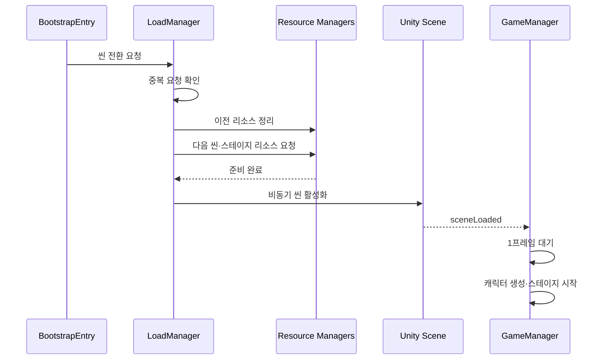

메인 씬은 스테이지에서 사용할 몬스터, SFX, VFX 준비가 끝난 뒤 활성화하도록 순서를 고정했습니다.

```csharp
private async UniTask LoadingMainScene()
{
    eSceneType type = eSceneType.main;

    StageResourceCache cache = LoadStageResources(type);
    LoadSceneResources(type);

    await WaitForLoadingResources(
        cache,
        _loadingToken.Token);

    await LoadUnitySceneAsync(type);
}
```

또한 `sceneLoaded` 직후에는 새 씬 객체의 `Start()`가 끝나지 않았을 수 있어 한 프레임을 기다린 뒤 캐릭터 생성과 스테이지 시작을 수행하도록 했습니다.

구조를 분석하는 과정에서 VFX 배치 로딩이 요청 ID 배열과 Addressables 반환 배열의 순서가 같다고 가정한 문제도 발견했습니다.

이는 기존의 인덱스 기반 매핑 대신 실제로 반환된 프리팹의 이름으로 `eVFXType`을 판별해 캐시에 등록하도록 수정했습니다.

```csharp
foreach (GameObject obj in result)
{
    if (!Enum.TryParse(obj.name, out eVFXType key))
        continue;

    VFXEntity resource = obj.GetComponent<VFXEntity>();

    if (resource == null)
        continue;

    CacheAssets(key, resource);
}
```

### 결과

- 씬 전환과 리소스 준비의 진입점을 `LoadManager`로 모았습니다.
- 필수 리소스 준비 → Unity 씬 활성화 → 씬 객체 초기화 → 게임 시작 순서를 명시했습니다.
- `GameManager`는 로딩 구현에서 분리되어 런타임 게임 상태와 시작 흐름에 집중하게 됐습니다.
- 캐시와 Addressables handle을 실제로 소유한 매니저가 함께 해제하도록 책임을 정리했습니다.
- 요청 순서와 반환 순서가 다를 때 다른 VFX가 캐시에 연결될 수 있었던 잠재 오류를 제거했습니다.

### 개선사항

씬별 로딩 방식 선택은 아직 `switch`에 남아 있어 씬 종류가 늘어나면 별도 로딩 전략으로 분리할 필요가 있습니다.

VFX 매핑은 프리팹 이름과 `eVFXType` 이름이 같다는 규칙에 의존하므로, 규모가 커지면 명시적인 `ID → AssetReference` 매핑이나 에디터 검증 도구가 필요합니다.

### 관련 코드

- `BootstrapEntry.cs`
- `LoadManager.cs`
- `GameManager.cs`
- `SFXManager.cs`
- `VFXManager.cs`
- `MonsterSpawner.cs`

---
<div style="page-break-before: always;"></div>
<a id="demon-n-defense"></a>

# Demon N Defense

<p align="center">
  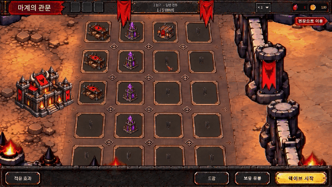
</p>

악마 군단을 육성하고 배치해 인간 군대의 침공을 막는 2D 오토배틀 디펜스 게임입니다. 5인 팀으로 개발해 2026년 11월 9일 STOVE에 출시했습니다. [STOVE 스토어](https://store.onstove.com/ko/games/106168)

- **팀 구성** : 개발 5인
- **역할** : 코어 시스템·분기·웨이브 밑 개발 중 UI 인계. 도감·플레이 기록을 구현하고 아웃게임 준비 씬의 초안을 제작했습니다.
- **개발 환경** : Unity 6, C#, UniTask

## 🧩 핵심 구현 1. 팀 모듈을 연결하는 웨이브 진행 구조

> **문제**
>
> 한 웨이브에서 전투가 끝나면 플레이어가 보상을 고르고 다음 웨이브를 준비합니다. 유물 카드를 고른 시점과 유물 효과가 실제 적용되는 시점이 달라, UI·유물·코어 담당자 사이에 보상 단계의 완료 기준이 필요했습니다.

### 해결

UI 와이어프레임에 플레이어가 무엇을 보고 선택하는지 그렸고, 게임 흐름도에는 각 입력을 어느 시스템이 처리하는지 표시했습니다. 두 자료를 놓고 팀원들과 모듈별 책임과 반환값을 정했습니다. 예를 들어 웨이브는 적 프리셋을 선택해 전달하고, 유닛 파트는 후보 ID와 가중치로 실제 병력을 편성하도록 합의했습니다. [게임 흐름도](https://app.diagrams.net/#G1kKwLJFC-wU5QC1A_7e1wA2vHiBrHJTWP#%7B%22pageId%22%3A%22EMV_Gr9QtNKrBiuXA8W_%22%7D)

승리 보상에서도 같은 방식으로 역할을 정했습니다. UI는 유물 후보를 보여주고 선택·포기 결과를 반환합니다. 유물 시스템은 선택된 유물을 획득하고 효과를 적용합니다. `GameFlowController`는 `SelectAndApplyAsync()`의 완료를 기다린 뒤 다음 단계를 결정합니다. [승리 화면 와이어프레임](https://www.figma.com/board/uOxwMPr209bRFGIVtwbkde/GL2_02_TowerDefense?node-id=205-1781) · [UI 인터페이스 논의](https://www.figma.com/board/uOxwMPr209bRFGIVtwbkde/GL2_02_TowerDefense?node-id=285-2250)

### 결과

유물 선택창이 열려 있는 동안 웨이브 진행은 대기합니다. 선택한 유물을 획득하지 못하면 같은 화면에서 다시 선택하고, 보상 처리가 완료되면 코어가 진행을 재개합니다. 이로써 개별 유물의 효과를 코어에 추가하지 않고도 전투 승리부터 다음 단계까지 연결했습니다. [유물 선택 UI 통합 커밋](https://github.com/OZ-GAME-LAB/OZGL2_2/commit/ef86eb37)

### 개선사항

다음 프로젝트에서는 흐름도에 입력별 종료 조건도 기록하고 싶습니다. 예를 들어 유물 획득을 포기하면 보상 단계를 마치고 게임을 계속하지만, 선택 대기 중 런이 종료되면 다음 웨이브로 넘어가서는 안 됩니다. 두 경우의 기대 결과를 인터페이스와 함께 정리하면 담당자들이 같은 기준으로 검증할 수 있습니다.

## 🧩 핵심 구현 2. 이어하기를 위한 저장·복원 책임 분리

> **문제**
>
> 이어하기에서는 웨이브 진행도와 함께 건물·재화·유물·소모품 상태도 복원해야 했습니다. 각 파트의 값이 정확해도 적용 순서가 달라지면 플레이 상태가 바뀝니다. 예를 들어 유물로 소모품 슬롯을 늘린 상태에서 저장했다면, 슬롯 내용을 불러오기 전에 유물 효과부터 복원해야 합니다.

### 해결

각 담당자가 자기 파트의 상태를 수집하고 복원하도록 공통 인터페이스를 정의했습니다. 코디네이터는 각 파트가 반환한 데이터를 하나의 체크포인트로 묶고, 이어하기를 시작하면 의존 관계에 맞춰 복원을 요청합니다.

```csharp
public interface ISaveDataProvider<T> where T : class
{
    T CaptureSaveData();
    void RestoreSaveData(T data);
}
```

### 결과

준비·보상 선택·이벤트·상점에서 저장한 런을 해당 단계부터 이어갈 수 있게 됐습니다. 이후 도감을 영구 저장에 연결할 때도 인게임과 아웃게임에서 같은 `ArchiveController`가 상태를 수집·복원하도록 했고, 씬에 다시 진입한 뒤에도 발견·읽음 상태가 유지되는 것을 확인했습니다. [체크포인트 저장·복원 커밋](https://github.com/OZ-GAME-LAB/OZGL2_2/commit/2a1b74d9) · [도감 저장 통합 커밋](https://github.com/OZ-GAME-LAB/OZGL2_2/commit/8efbb6bc)

### 개선사항

AI를 활용해 도감 저장을 확장했을 때, 초안의 코디네이터가 도감 상태 사본까지 보유해 같은 데이터를 두 곳에서 관리하는 문제를 발견했습니다. 사본을 제거하고 도감 컨트롤러에 상태 관리를 맡겼습니다. 이 경험을 통해 구현을 요청할 때 저장할 값뿐 아니라 그 값을 소유하는 객체와 다른 모듈이 호출할 수 있는 메서드까지 명시해야 한다는 점을 배웠습니다.

현재는 새 Provider를 추가할 때 코디네이터에 직접 연결합니다. 다음 프로젝트에서는 시작 로딩 중 리플렉션으로 Provider를 수집하는 방식을 검토하고 싶습니다. 등록을 자동화하더라도 유물과 소모품처럼 순서에 의미가 있는 파트의 복원 순서는 명시적으로 관리할 계획입니다.

---
<div style="page-break-before: always;"></div>

<a id="team-project-2"></a>
# 2차 팀 프로젝트: 귀차니즘 용사

<p align="center">
  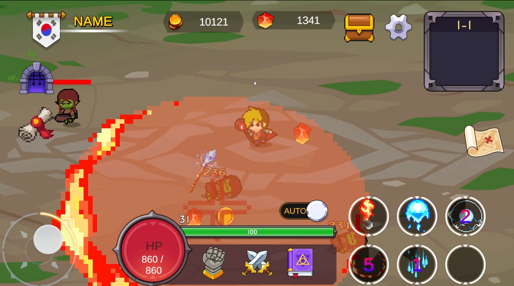
  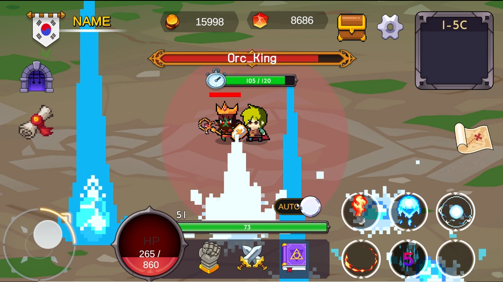
</p>

<p align="center">
  <b>일반 스테이지 파밍과 보스 스테이지 돌파로 이어지는 방치형 RPG</b><br/>
  <sub>클라이언트 리드로 공통 프레임워크와 초기화·데이터·이벤트 규약, 통합 흐름을 담당했습니다.</sub>
</p>


- **개발 기간** : 2026.03.03 - 2026.04.15, 약 6주
- **팀 구성** : 개발 4인
- **역할** : 클라이언트 리드
- **개발 환경** : Unity 2022.3.62f3 LTS, C#, UniTask, Addressables
- **GitHub** : [https://github.com/ks0521/TeamProject](https://github.com/ks0521/TeamProject)
- **시연 영상** : [YouTube](https://youtu.be/7LdXl2Ow0QU)

<a id="idle-hero-bootstrap"></a>
## 🧩 핵심 구현 1. Addressables 데이터 로딩·매니저 초기화 순서 보장

> **문제**  
> 팀 코드를 통합하면서 Unity 생명주기와 매니저 의존성이 얽혔고, 필수 데이터가 준비되기 전에 시스템이 참조될 위험이 있었습니다.

### 해결

`StartBootstrap`을 단일 진입점으로 두고 Stage, Equipment, Item, Currency 데이터를 병렬 로딩했습니다. 데이터 준비가 끝난 뒤에만 `GameManager`가 `IManager` 구현체를 우선순위대로 초기화합니다.

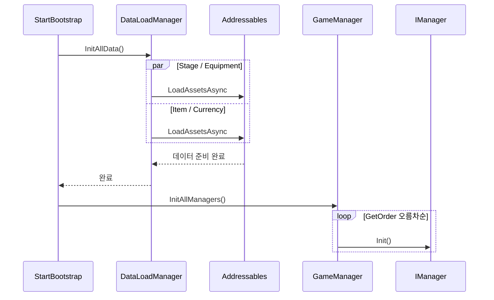

```csharp
// StartBootstrap.cs
await dataLoadManager.InitAllData(dic);
gameManager.InitAllManagers();

// DataLoadManager.cs
await UniTask.WhenAll(
    LoadAllStage(),
    LoadAllEquipment(),
    LoadAllItems(),
    LoadAllCurrency()
);
```


### 결과

- 데이터 그룹의 준비 완료 시점을 매니저 초기화보다 앞에 고정했습니다.
- 신규 매니저는 `IManager` 구현과 우선순위 지정으로 초기화 흐름에 편입할 수 있습니다.
- 데이터 로딩 실패를 부트스트랩 단계에서 감지할 수 있습니다.

### 개선사항

 정수 기준 우선순위는 단순하지만 값 충돌과 숨은 의존성을 만들 수 있었습니다. 규모가 커지면 실제 의존 대상을 명시하는 그래프 또는 DI 기반 초기화로 전환해야 할 필요성을 경험했습니다.

### 관련 코드

- [StartBootstrap.cs](https://github.com/ks0521/TeamProject/blob/main/Assets/Game/Base/Data/Script/StartBootstrap.cs)
- [DataLoadManager.cs](https://github.com/ks0521/TeamProject/blob/main/Assets/Game/Base/Managers/DataLoadManager.cs)
- [GameManager.cs](https://github.com/ks0521/TeamProject/blob/main/Assets/Game/Base/Managers/GameManager.cs)

<a id="idle-hero-stage"></a>
## 🧩 핵심 구현 2. 스테이지 실행·클리어 규칙·보상 책임 분리

> **문제**  
> 전환, 스폰, 클리어 판정, 보상을 한 흐름에서 처리하면 새로운 규칙을 추가할 때 진행 코드 전체를 수정해야 했습니다.

### 해결

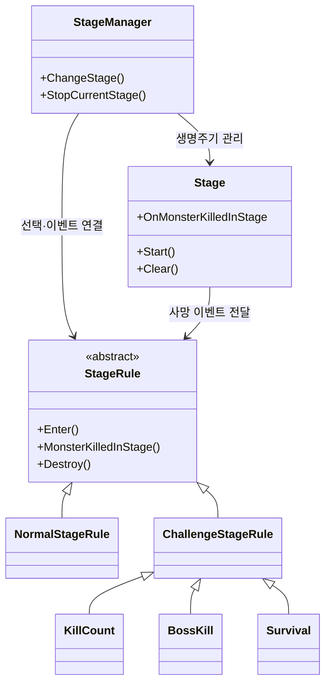

`StageManager`는 전환과 진행 상태, `Stage`는 스폰과 몬스터 생명주기, `StageRule`은 클리어 조건과 보상을 담당합니다. 일반 보상, 처치 수, 보스 처치, 생존 규칙을 기존 진행 흐름에 연결했습니다.

### 한계
현재 규칙 선택은 `StageManager`의 분기에 남아 있습니다. 이 한계는 다음 프로젝트에서 `StageDefinition`과 `StageRuleFactory`를 도입하는 계기가 됐습니다.

### 관련 코드

- [StageManager.cs](https://github.com/ks0521/TeamProject/blob/main/Assets/Game/Base/Managers/StageManager.cs)
- [Stage.cs](https://github.com/ks0521/TeamProject/blob/main/Assets/Game/Battle/Script/Stage.cs)
- [StageRule.cs](https://github.com/ks0521/TeamProject/blob/main/Assets/Game/Battle/Script/StageRule.cs)
<div style="page-break-before: always;"></div>

## 🧩 핵심 구현 3. Attribute·Reflection 기반 저장 / 런타임 데이터 변환

> **문제**  
> Unity `JsonUtility`는 `Dictionary` 직렬화를 지원하지 않아 저장용 데이터와 런타임 데이터 타입을 분리해야 했습니다.  
> 콘텐츠가 늘어나면서 공통 필드를 모두 수동 복사하여 전환 시 누락 위험이 생겼습니다.

### 해결
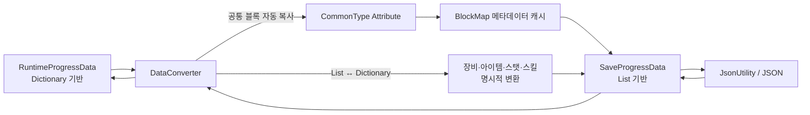

공통 블록은 `[CommonType]`속성을 붙여 Reflection으로 자동 복사하고, 장비·아이템·스탯·스킬처럼 `List ↔ Dictionary` 변환이 필요한 블록만 명시적으로 변환했습니다. 
<br/>필드 이름과 타입 정보같은 Reflection에 필요한 메타데이터는 `BlockMap`으로 캐싱해 저장/로드 시 반복 탐색 비용도 줄였습니다.

### 한계
Reflection은 컴파일 단계 검증이 약하므로 필드 이름 변경 시 경고와 변환 테스트가 필요합니다. 
<br/>이 프로젝트에서는 구조를 구현했지만 자동화된 회귀 테스트까지는 완성하지 못했습니다.

### 관련 코드

- [DataConverter.cs](https://github.com/ks0521/TeamProject/blob/main/Assets/Game/Base/Save/DataConverter.cs)
- [CommonTypeData.cs](https://github.com/ks0521/TeamProject/blob/main/Assets/Game/Base/Save/CommonTypeData.cs)

## ✍️ 회고

### 일정·범위 관리 측면
이번 프로젝트에서는 기능 구현보다 먼저 **초기화 순서**, **데이터 진입점**, **이벤트 규약**을 문서로 합의했습니다.  
초기에 합의 비용은 들었지만, 병렬 개발 단계에서 **누가 언제 어떤 데이터를 신뢰할 수 있는지** 기준이 명확해져 통합 충돌을 줄일 수 있었습니다.  
특히 후반부 QA에서 이슈를 수정할 때 원인 추적 경로가 짧아져, 기능 간 책임 경계를 재확인하는 데 도움이 됐습니다.

### 기술적 측면
1차 팀 프로젝트에서 겪었던 초기화 타이밍 이슈를 해결하기 위해 `StartBootstrap → DataLoadManager → GameManager` 순서로 진입점을 고정했습니다.  
또한 개인 프로젝트에서 검증한 책임 분리 원칙을 `StageManager / Stage / StageRule`로 확장해 스테이지 규칙을 교체 가능한 단위로 분리했습니다.  
결과적으로 **초기화 안정성**, **데이터 준비 상태 보장**, **콘텐츠 규칙 확장성**을 확보했습니다.

그러나 초기화 의존성을 정수 우선순위로 표현해 시스템 간 관계가 코드에 명확하게 드러나지 않았고, 스테이지 규칙 선택도 `StageManager`의 조건 분기에 남아 있었습니다. 또한 `Stage`가 몬스터 스폰과 런타임 진행 상태를 함께 관리해 콘텐츠 종류가 늘어날수록 수정 범위가 다시 커질 가능성이 있었습니다.

왕국군 키우기에서는 이 경험을 바탕으로 리소스 준비, 씬 활성화, 런타임 초기화의 완료 조건을 구분했습니다. 스테이지 구조도 정적 설정을 담는 `StageDefinition`, 현재 진행 상태를 관리하는 `StageSession`, 클리어 여부를 판정하는 `IStageRule`, 몬스터 생성을 담당하는 `StageSpawnController`로 세분화했습니다. 규칙 생성은 `StageRuleFactory`로 이동해 `StageManager`가 구체적인 규칙 클래스를 직접 선택하지 않도록 개선했습니다.

이를 통해 책임 분리는 클래스를 나누기만 하면 되는것이 아니라 서로 다른 시점과 이유로 변경되는 데이터와 동작을 독립적으로 구분하는 과정이라는 점을 배웠습니다.
  
---
<div style="page-break-before: always;"></div>

<a id="personal-project"></a>
# 개인 프로젝트: 그때 갑자기 건담이 나타났다

<p align="center">
  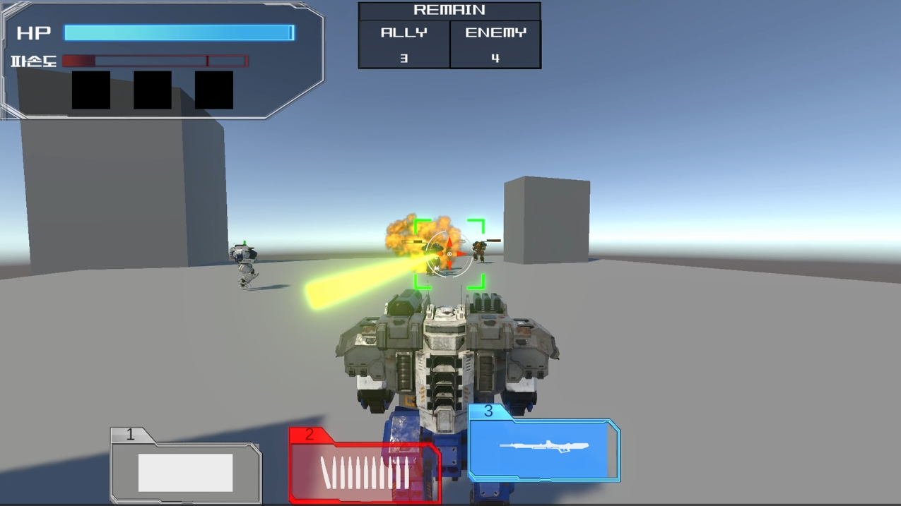
  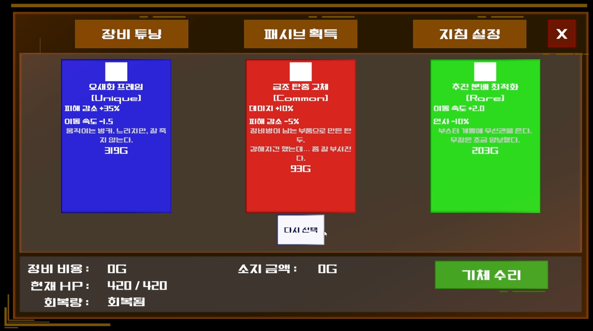
</p>


<p align="center">
  <b>불리한 전투 상황을 돌파하며 무작위 보상으로 기체를 강화하는 TPS 로그라이크</b><br/>
  <sub>1인 개발로 플레이어/AI 공통 전투 실행 계층, 공격 파이프라인, 상태 전이 기반 NPC AI를 구현했습니다.</sub>
</p>

- **개발 기간** : 2026.01.29 - 2026.02.27, 총 4주
- **후속 보완** : 2026.03–04, 공격 파이프라인 책임 재정리와 오류 수정
- **팀 구성** : 1인 개발
- **개발 환경** : Unity 2022.3.62f3 LTS, C#, UniTask
- **GitHub** : [https://github.com/ks0521/SingleProject](https://github.com/ks0521/SingleProject)
- **기획서** : [Notion](https://www.notion.so/2f110afad1cd80fd868de0a4df86b3fe)

<a id="personal-combat"></a>
## 🧩 핵심 구현 1. 입력 주체와 공통 전투 실행 계층 분리

> **문제**  
> 플레이어와 AI는 입력을 결정하는 방식이 다르지만 실제 기체의 이동·회전·공격·피격 경직은 동일한 규칙으로 동작합니다.
> <br/>각 컨트롤러가 기체 동작을 직접 구현하면 같은 기능이 중복되고, 물리 이동이나 경직 처리 방식을 변경할 때 양쪽 코드를 함께 수정해야 하는 문제가 있었습니다.

### 해결

플레이어 입력과 AI 판단은 각각의 컨트롤러에 남겨두고 실제 기체 동작은 MechBehavior에서 공통으로 실행하도록 분리했습니다.

플레이어 측에서는 PlayerController가 이동 입력을 해석하고 PlayerWeaponController가 공격 입력과 무기 교체를 담당합니다. AI 측에서는 NPCController가 현재 상태와 타겟 조건을 바탕으로 이동 방향과 공격 시점을 결정합니다.

두 주체가 결정한 이동과 공격 요청은 MechBehavior로 전달되며, MechBehavior는 Rigidbody 기반 이동, 방향 전환, 공격 실행 요청, 피격 경직처럼 기체에 공통으로 필요한 동작을 처리합니다.

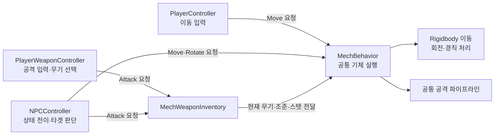

### 효과

- 입력 주체가 달라도 동일한 전투 실행 로직을 재사용할 수 있었습니다
- 이동/공격/피격 경직 같은 핵심 동작의 수정 지점을 `MechBehavior` 중심으로 모을 수 있었습니다.
- Raycast, 근접 공격, handler 기반 공격을 동일한 무기 진입점에서 분기합니다.

### 관련 코드

- [PlayerController.cs](https://github.com/ks0521/SingleProject/blob/main/Assets/Gundam/Game/Script/Contents/Player/PlayerController.cs)
- [NPCController.cs](https://github.com/ks0521/SingleProject/blob/main/Assets/Gundam/Game/Script/Contents/NPC/NPCController.cs)
- [MechBehavior.cs](https://github.com/ks0521/SingleProject/blob/main/Assets/Gundam/Game/Script/Contents/Mech/MechBehavior.cs)
<div style="page-break-before: always;"></div>

## 🧩 핵심 구현 2. 공격 요청·가능 판정·무기 실행 파이프라인 분리

> **문제**  
> 기존에는 공격 요청 처리, 재장전·공격 딜레이 검사, 최종 스탯 계산, 무기 타입별 실행, 탄약과 재장전 상태를 한 클래스에서 관리하는 방식을 사용했지만 이로 인해 새로운 공격 방식을 추가하거나 공격 실패 원인을 추적하기 어려웠습니다.

### 해결

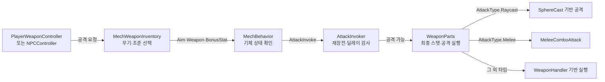

공격 흐름을 요청 전달, 공격 가능 판정, 무기별 실행의 세 단계로 분리했습니다.

MechWeaponInventory는 현재 무기와 조준 정보를 선택하고 MechBehavior는 기체가 공격 가능한 상태인지 확인한 뒤 요청을 AttackInvoker에 전달합니다.

AttackInvoker는 현재 무기의 재장전 상태와 공격 딜레이를 검사합니다. <br/>공격할 수 있는 경우에만 WeaponParts.Attack()을 호출하며 WeaponParts는 무기 데이터와 추가 스탯을 조합해 최종 공격 수치를 계산하고 공격 타입에 맞는 실행 경로를 선택합니다.

### 효과

공격이 실행되지 않았을 때 원인을 다음 단계로 나누어 확인할 수 있게 되었습니다.

`입력·AI 판단
→ 현재 무기 선택
→ 기체 제어 가능 여부
→ 재장전·공격 딜레이
→ 무기별 공격 실행`

공격 가능 판정과 실제 공격 방식이 분리되어 Raycast와 근접 공격처럼 실행 방식이 다른 무기도 동일한 진입점을 사용할 수 있게 되었습니다. 

무기별 탄약과 딜레이 상태도 각 WeaponParts 인스턴스가 관리하므로 무기 교체 시 상태를 독립적으로 유지할 수 있습니다.

### 개선사항

WeaponParts가 최종 스탯 계산, 공격 타입 분기, 탄약, 딜레이, 재장전까지 담당해 책임이 여전히 많습니다. <br/>
공격 타입이 더 늘어난다면 공격 타입별 실행을 각각 전략 객체로 분리하고, WeaponParts는 무기 상태와 실행 전략 선택만 담당하도록 개선하는 방식을 고려하고 있습니다.

공격 실패 결과가 현재 bool 중심이므로 실패 원인을 구분할 수 없습니다.<br/>
UI나 AI가 실패 원인을 구분해야 한다면 Reloading, Delay, CannotControl, NoAmmo와 같은 명시적인 결과 타입이 필요합니다.

### 관련 코드

- [AttackInvoker.cs](https://github.com/ks0521/SingleProject/blob/main/Assets/Gundam/Game/Script/Contents/Mech/AttackInvoker.cs)
- [WeaponParts.cs](https://github.com/ks0521/SingleProject/blob/main/Assets/Gundam/Game/Script/Contents/Weapon/WeaponParts.cs)
<div style="page-break-before: always;"></div>

## 🧩 핵심 구현 3. 상태 전이 기반 NPC AI·ScriptableObject 파라미터 분리

> **문제**  
> NPC가 단순 추적/공격만 수행하면 전투 상황 변화에 대응하기 어렵고, AI 행동 값을 코드 수정 없이 조정하기 어렵습니다.

### 해결

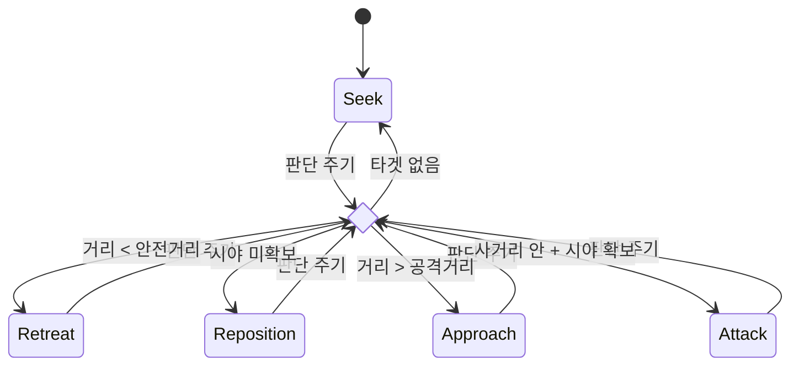

NPC는 일정 판단 주기마다 타겟 유효성, 거리, 시야를 계산해 `Seek`, `Approach`, `Attack`, `Retreat`, `Reposition`, `Stunned` 여섯 개의 활성 상태를 선택합니다. 
<br/> 현재는 `Stunned` 전이 조건이 비활성화되어 거리와 시야를 기준으로 다섯 개 상태를 선택합니다.

공격 거리·안전거리·판단 주기 같은 파라미터는 ScriptableObject로 분리해 기체 타입별 성향을 조정할 수 있게 했습니다. 

### 상태별 실행

- `Seek`: 타겟 탐색 또는 정지
- `Approach`: 타겟 방향 접근
- `Retreat`: 안전거리 밖으로 후퇴
- `Reposition`: 시야 확보를 위한 측면 이동
- `Attack`: 공격과 저속 측면 이동

### 개선사항

상태와 전이 수가 더 늘어나거나 각 상황에 맞는 효과가 필요하다면 NPC의 상태를 switch로 관리하지 않고 FSM으로 관리하는 방식으로 변경하려고 합니다.

### 관련 코드

- [NPCController.cs](https://github.com/ks0521/SingleProject/blob/main/Assets/Gundam/Game/Script/Contents/NPC/NPCController.cs)

## ✍️ 회고

### 일정·범위 관리 측면
전투-보상-최종 전투 루프 MVP는 완성했지만, UI 구현에 일정이 편중되어 난이도 곡선/적 조합 다양화까지는 충분히 고도화하지 못했습니다.  
이후에는 핵심 루프 완성 기준을 먼저 정의하고, 부가 기능은 후순위로 배치하는 방식으로 범위를 관리하려고 합니다.

### 기술적 측면
플레이어와 NPC의 입력 주체는 분리하되, 실제 전투 실행은 `MechBehavior` 계층으로 공통화해 로직 중복을 줄였습니다.  
또한 `AttackInvoker`(공격 가능 판정)와 `WeaponParts`(무기별 실행)로 공격 흐름을 단계화해, 문제 발생 시 입력/판정/실행 중 어디에서 오류가 났는지 빠르게 분리할 수 있게 했습니다.  
이 구조는 이후 2차 팀 프로젝트에서 **초기화·데이터·규칙** 단위를 분리하는 설계 판단의 기반이 되었습니다.

---
<div style="page-break-before: always;"></div>

<a id="team-project-1"></a>
# 1차 팀 프로젝트: 카미카쿠시

<p align="center">
  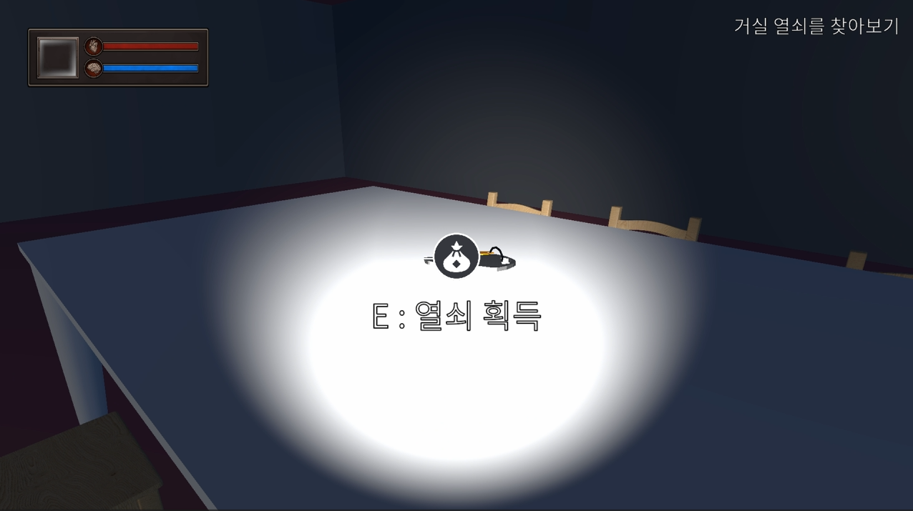
  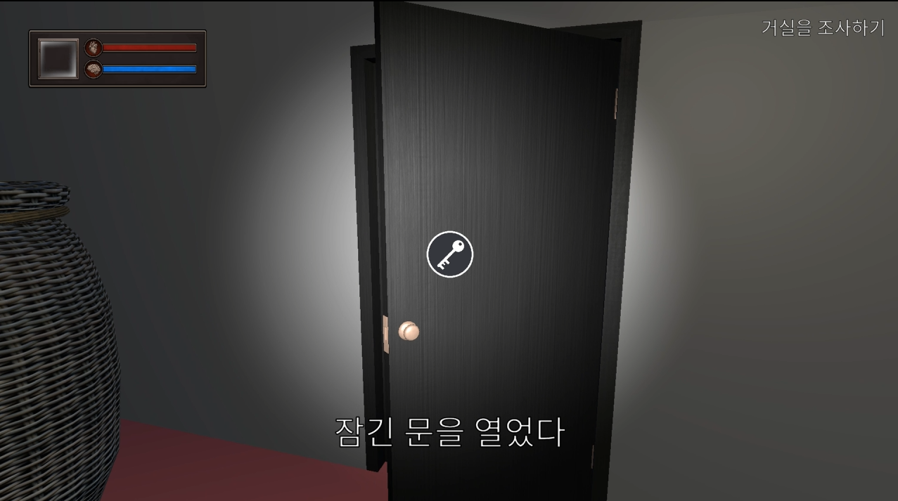
  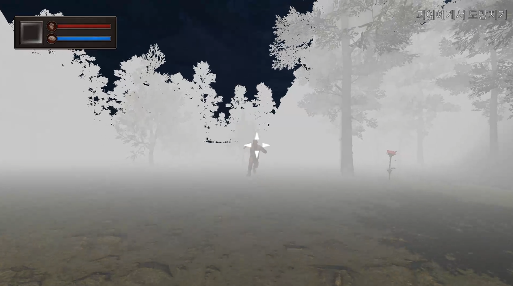
</p>

<p align="center">
  <b>마을을 탐색하며 단서를 수집하고 선택에 따라 사건의 결말이 달라지는 공포 게임</b><br/>
  <sub>클라이언트 리드로 인터페이스 기반 상호작용 시스템과 Raycast 탐지, 이벤트 기반 UI 반응 구조를 구현했습니다.</sub>
</p>

- **개발 기간** : 2025.12.10 - 2025.12.26, 약 2주
- **팀 구성** : 기획 1인, 아트 1인, 개발 3인
- **역할** : 클라이언트 리드
- **개발 환경** : Unity 2022.3.62f2 LTS, C#, Coroutine
- **GitHub** : [https://github.com/ks0521/First-Game-Project](https://github.com/ks0521/First-Game-Project)
- **시연 영상** : [YouTube](https://www.youtube.com/watch?v=v1zOEZXVuqY)

<a id="kamikakushi-interaction"></a>
## 🧩 핵심 구현 1. Condition·Action 조합형 상호작용 구조

> **문제**  
> 아이템, 문, 단서, 회복 오브젝트마다 상호작용 조건과 실행 동작을 개별 스크립트로 작성하면 비슷한 코드가 반복됩니다. <br/>새로운 오브젝트를 추가할 때마다 플레이어 상호작용 코드까지 수정하면 콘텐츠가 늘어날수록 제작 속도가 느려지고 기존 기능에 영향을 줄 가능성도 커집니다.

### 해결

모든 상호작용 대상을 IInteractable로 추상화하고, 상호작용 가능 조건과 상호작용 시 실행 동작을 각각 IInteractionCondition, IInteractAction 컴포넌트로 분리했습니다.

InteractItems는 자신에게 부착된 조건과 액션 컴포넌트를 수집합니다. 상호작용 요청을 받으면 모든 조건을 검사하고, 성공한 경우 실행할 액션 목록을 InteractResult에 담아 반환합니다.

새로운 오브젝트는 기존 플레이어 코드를 수정하지 않고 필요한 조건과 액션 컴포넌트를 추가·제거하거나 조합해 제작할 수 있습니다.
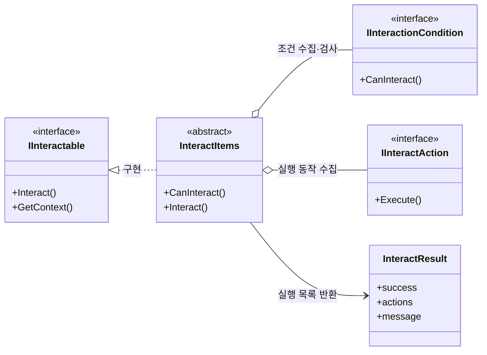

### 오브젝트 구성 예시

| 오브젝트 | 조건 컴포넌트(IInteractionCondition) | 액션 컴포넌트(IInteractAction) |
| --- | --- | ---|
| 일반 아이템 | 조건 없음 | 아이템 획득, 오브젝트 제거 |
| 잠긴 문 | 특정 열쇠 보유 | 열쇠 소비, 문 열기 |
| 회복 아이템 | 조건 없음 | 체력 회복, 오브젝트 제거 |
| 단서 | 특정 진행 단계 | 목표 변경, 안내 UI 표시 |
| 엔딩 트리거 | 선택지 완료 | 엔딩 상태 변경, 씬 전환 |

### 효과

새로운 상호작용 오브젝트를 추가할 때 플레이어 코드를 수정하지 않고 기존 조건과 액션을 조합해서 제작할 수 있었습니다.

잠긴 문처럼 기존 조합으로 표현 가능한 콘텐츠는 별도의 상호작용 절차를 다시 구현할 필요가 없으며 조건 또는 실행 방식이 변경되더라도 해당 컴포넌트만 수정할 수 있습니다.

### 개선사항

컴포넌트 조합을 통해 재사용성을 높였지만 한 오브젝트에 조건과 액션이 많아지면 Inspector만 보고 실행 순서와 의도를 파악하기 어렵습니다.

액션 실행 순서가 결과에 영향을 주는 경우 명시적인 우선순위나 검증 도구가 필요하며, 잘못된 컴포넌트 조합을 방지하려면 에디터 단계에서 구성 검사가 필요합니다.

### 관련 코드

- [IInteractable.cs](https://github.com/ks0521/First-Game-Project/blob/main/Assets/_Kamikakushi/Scripts/Utills/Interfaces/IInteractable.cs)
- [IInteractionCondition.cs](https://github.com/ks0521/First-Game-Project/blob/main/Assets/_Kamikakushi/Scripts/Utills/Interfaces/IInteractionCondition.cs)
- [IInteractAction.cs](https://github.com/ks0521/First-Game-Project/blob/main/Assets/_Kamikakushi/Scripts/Utills/Interfaces/IInteractAction.cs)
- [InteractItems.cs](https://github.com/ks0521/First-Game-Project/blob/main/Assets/_Kamikakushi/Scripts/Contents/Object/Interective%20Object/InteractItems.cs)
- [PlayerInteract.cs](https://github.com/ks0521/First-Game-Project/blob/main/Assets/_Kamikakushi/Scripts/Contents/Player/PlayerInteract.cs)
<div style="page-break-before: always;"></div>

## 🧩 핵심 구현 2. Raycast 탐지·상호작용 실행·UI 이벤트 흐름 분리

> **문제**  
> 하나의 컴포넌트에서 Raycast 탐지, 대상 보관, 상호작용 실행, 결과 표시까지 모두 담당하면 탐지 방식이나 UI를 변경할 때 상호작용 로직도 함께 수정해야 했습니다.<br/>기능이 늘어날수록 플레이어 코드가 UI와 구체적인 오브젝트 구현을 직접 참조하게 되어 각 기능을 독립적으로 수정하기 어려워졌습니다.

### 해결

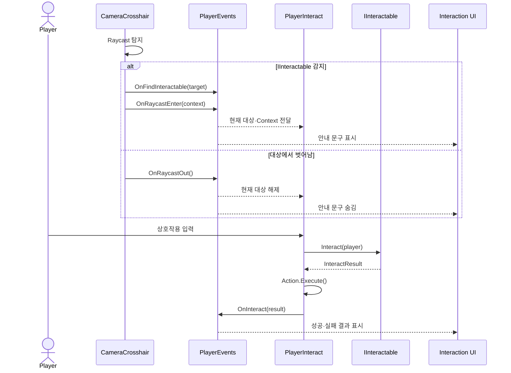

물체를 발견하고 상호작용 결과를 표시하기까지의 절차를 탐지, 이벤트 전달, 실행, UI 반응으로 분리했습니다.

- CameraCrosshair: 카메라 전방 Raycast와 상호작용 대상 탐지
- PlayerEvents: 탐지 대상, 안내 문맥, 상호작용 결과 전달
- PlayerInteract: 현재 대상 관리, 입력 확인, 상호작용 실행
- Interaction UI: 안내 문구와 성공·실패 결과 표시
- IInteractable: 오브젝트별 조건 검사와 실행 결과 생성
  
### 효과

탐지 방식, 상호작용 실행, UI 표시를 이벤트로 느슨하게 연결하여 각 파트를 독립적으로 수정할 수 있게 되었습니다.

Raycast 대상이 바뀌면 UI와 PlayerInteract가 같은 이벤트를 통해 각자 상태를 갱신하며, UI 디자인을 변경해도 탐지 또는 오브젝트 로직을 수정할 필요가 없습니다.<br/>
상호작용이 실패한 경우에도 결과 메시지를 동일한 이벤트 경로로 전달할 수 있습니다.

### 개선사항

이벤트 기반 연결 구조로 직접 참조를 줄였지만 호출 경로가 코드에 명시적으로 드러나지 않아 디버깅이 제한되는 경우가 있었습니다.<br/>
이벤트 구독 해제 누락으로 중복 호출이나 파괴된 객체 참조가 발생할 가능성도 있습니다.

### 관련 코드

- [CameraCrosshair.cs](https://github.com/ks0521/First-Game-Project/blob/main/Assets/_Kamikakushi/Scripts/Contents/Player/CameraCrosshair.cs)
- [PlayerInteract.cs](https://github.com/ks0521/First-Game-Project/blob/main/Assets/_Kamikakushi/Scripts/Contents/Player/PlayerInteract.cs)
- [PlayerEvents.cs](https://github.com/ks0521/First-Game-Project/blob/main/Assets/_Kamikakushi/Scripts/Contents/Player/PlayerEvents.cs)

## ✍️ 회고

### 일정·범위 관리 측면
개발 중 인원 이탈이 발생하면서 기존 대형 맵 중심 계획을 그대로 유지하기 어려워졌고, 튜토리얼-단서 탐색-선택 분기-멀티 엔딩 구조로 범위를 재설계했습니다.  
핵심은 축소 과정에서 **플레이어가 끝까지 경험하는 루프**를 남기는 것이었고, 이에 따라 맵 규모보다 분기 경험의 완성도를 우선했습니다.  
이 과정에서 제한된 일정일수록 기능 수보다 전달할 경험의 중심축을 먼저 확정해야 한다는 운영 기준을 얻었습니다.

### 기술적 측면
상호작용을 `IInteractable / IInteractionCondition / IInteractAction`으로 분리하고, `PlayerEvents`로 탐지·실행·UI를 분리해 결합도를 낮췄습니다.  
다만 통합 단계에서 매니저 초기화 시점이 명확하지 않아, 특정 기능이 준비되기 전에 참조되는 타이밍 이슈를 반복적으로 겪었습니다.  
이 실패 경험이 다음 프로젝트에서 초기화 파이프라인을 명시적으로 설계한 직접적인 출발점이 되었고, 이후에는 **기능 구현 전 진입 순서 고정**을 필수 규칙으로 두게 됐습니다.

